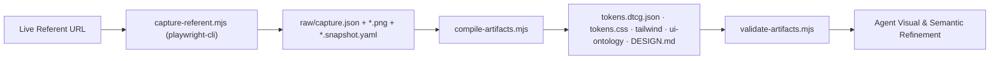

<div align="center">
  
  <h1>Refract</h1>
  <p>
    <strong>Reverse-engineer any live website into W3C Design Tokens, CSS variables, Tailwind v4/v3 themes, structured UI ontologies, and agent-ready <code>DESIGN.md</code> specs.</strong>
  </p>
  <p>
    Multi-provider plugin for <strong>Claude Code</strong>, <strong>Antigravity</strong>, <strong>Codex</strong>, and <strong>Cursor</strong> &mdash; plus a zero-dependency Node.js CLI.
  </p>

  <p>
    <a href="LICENSE"></a>
    <a href="#prerequisites">= 18" height="20" /></a>
    <a href="#prerequisites"></a>
    <a href="#claude-code"></a>
    <a href="#antigravity"></a>
    <a href="#codex"></a>
    <a href="#cursor"></a>
    <a href="docs/output-formats.md#1-tokensdtcgjson-w3c-dtcg"></a>
  </p>
</div>

---

## Why Refract?

Asking an AI agent to "copy this website's style" from a single screenshot hallucinates hex codes, misses dark-mode overrides, guesses hover/focus transitions, and blurs visual tokens with layout structure. **Refract** measures first and refines second:

| Capability | Screenshot-Only Prompting | **Refract** |
| --- | --- | --- |
| **Color & Contrast** | Approximated hex values | Exact CSS variables + computed colors + WCAG 2.1 contrast pairing |
| **Themes & Viewports** | Single static frame | Multi-state matrix (`desktop-light`, `desktop-dark`, `mobile-light`) |
| **Interactive States** | Ignored or invented | Live Playwright `:hover` & `:focus-visible` style delta probing |
| **UI Ontology** | Unstructured prose | Formal YAML/JSON regions, component slots, composition & invariants |
| **Output Portability** | One-off CSS | W3C DTCG JSON, CSS vars, Tailwind v4 `@theme`, Tailwind v3 config, `DESIGN.md` |

## How It Works



---

## Prerequisites

- **Node.js `>= 18`** (uses built-in `node:*` APIs only — **zero external npm packages**)
- **`playwright-cli`** available on `PATH` (or via `PLAYWRIGHT_CLI_BIN`) with Chromium installed

---

## Quick Start

### Claude Code

Run directly with a local checkout:

```bash
claude --plugin-dir /path/to/refract
```

Or install from a GitHub marketplace (on Claude Code 2.1.275+):

```text
/plugin install refract --marketplace tammai/refract
```

Validate strictly:

```bash
claude plugin validate --strict /path/to/refract
```

Invoke inside Claude Code:
- `/refract:extract-referent https://example.com --out ./design-referent`
- `/refract:audit-ui-ontology ./design-referent`
- Delegate to the **`referent-analyst`** subagent

### Antigravity

Validate and install locally:

```bash
agy plugin validate --strict /path/to/refract
agy plugin install /path/to/refract
```

Invoke inside Antigravity:
- `/extract-referent` or `/audit-ui-ontology`
- `agy --agent referent-analyst`

### Codex

Install from a Codex marketplace repository (using `.codex-plugin/plugin.json`) or install skills locally into `~/.agents/skills/`:

```bash
mkdir -p ~/.agents/skills
ln -s /path/to/refract/skills/extract-referent ~/.agents/skills/extract-referent
ln -s /path/to/refract/skills/audit-ui-ontology ~/.agents/skills/audit-ui-ontology
```

Invoke inside Codex:
- `$extract-referent https://example.com --out ./design-referent`
- `$audit-ui-ontology ./design-referent`

### Cursor

Install as a Cursor plugin (configured via `.cursor-plugin/plugin.json`), or copy `.cursor/rules/refract-guardrails.mdc` and `skills/` into a project:

- Invoke skills in Agent chat via `/extract-referent` or `/audit-ui-ontology`
- Delegate to the bundled **`referent-analyst`** agent
- Guardrails in `.cursor/rules/refract-guardrails.mdc` apply automatically when working with referent extractions or `DESIGN.md`

### Standalone CLI

Run the full capture + compile + validation pipeline from any terminal:

```bash
node skills/extract-referent/scripts/capture-referent.mjs https://example.com \
  --out ./referent-output \
  --compile
```

---

## Output Artifacts

Every run produces raw multi-state captures in `raw/` plus **7 validated artifacts** (see [Output Formats](docs/output-formats.md) for full schemas):

| Artifact | Purpose |
| --- | --- |
| `tokens.dtcg.json` | Three-tier (`primitive` &rarr; `semantic` &rarr; `component` + `modes.dark`) W3C DTCG JSON |
| `tokens.css` | CSS custom properties with `:root`, `prefers-color-scheme: dark`, and `.dark` |
| `tailwind.theme.css` | Tailwind CSS v4 `@theme` configuration |
| `tailwind.config.mjs` | Tailwind CSS v3 `theme.extend` ESM configuration |
| `ui-ontology.yaml` | Human-readable regions, surfaces, component slots, state deltas & invariants |
| `ui-ontology.json` | Machine-readable JSON mirror of the UI ontology |
| `DESIGN.md` | Agent-ready design specification with concrete DO / DON'T reproduction rules |

---

## Documentation & Guides

- [**Getting Started**](docs/getting-started.md) — Setup, CLI flags, and workflows for Claude Code, Antigravity, Codex, Cursor, and standalone CLI
- [**Architecture**](docs/architecture.md) — Multi-state capture matrix, color clustering, WCAG pairing, and multi-provider layout
- [**Output Formats**](docs/output-formats.md) — Detailed reference and integration snippets for all 7 output artifacts
- [**Troubleshooting**](docs/troubleshooting.md) — Resolving `PATH`, SPA hydration delays, CORS stylesheets, and alias checks
- [**GitHub SEO & Launch Guide**](docs/github-seo.md) — Repository topics, About description, `social-preview.svg`, and marketplace checklist
- [**Wiki**](https://github.com/tammai/refract/wiki) — Complete multi-page knowledge base (source in [`wiki/`](wiki/))

---

## FAQ

<details>
<summary><strong>Does Refract support Tailwind CSS v4 and v3?</strong></summary>

Yes. Every extraction emits both `tailwind.theme.css` (`@theme { ... }` for Tailwind v4) and `tailwind.config.mjs` (`theme.extend` ESM config for Tailwind v3).

</details>

<details>
<summary><strong>Does it work on React, Next.js, or client-rendered SPAs?</strong></summary>

Yes. `capture-referent.mjs` drives a real headless Chromium browser via `playwright-cli`, waits for `document.fonts.ready` plus a configurable `--wait` delay, and reads live computed styles and DOM/ARIA trees after hydration.

</details>

<details>
<summary><strong>How are light and dark themes captured?</strong></summary>

By default, Refract captures `desktop-light` (`1440×900`, `light`), `desktop-dark` (`1440×900`, `dark`), and `mobile-light` (`390×844`, `light`). Measured dark-mode differences are emitted automatically under `modes.dark` in `tokens.dtcg.json` and `@media (prefers-color-scheme: dark)` / `.dark` in `tokens.css`.

</details>

<details>
<summary><strong>Does Refract check WCAG contrast and accessibility?</strong></summary>

Yes. Refract alpha-composites the effective opaque background behind sampled text elements to compute WCAG 2.1 contrast ratios, audits heading level order (`h1`&ndash;`h6`), probes `:focus-visible` outlines, and counts mobile interactive touch targets under `44×44px`.

</details>

---

## Contributing, Security & License

- Read [CONTRIBUTING.md](CONTRIBUTING.md) for development guidelines and CI checks.
- Read [SECURITY.md](SECURITY.md) for safe capture practices and vulnerability reporting.
- See [CHANGELOG.md](CHANGELOG.md) for release history.
- Released under the [MIT License](LICENSE).
