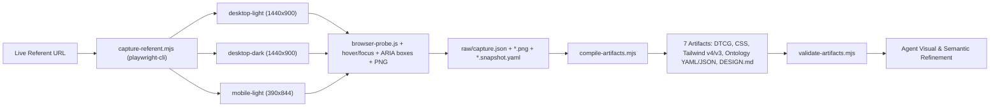

# Architecture

Refract pairs **deterministic headless browser telemetry** with **visual and semantic agent refinement** so extracted design systems stay grounded in measured reality instead of screenshot guesswork.

## Extraction Pipeline



## Stage 1: Multi-State Browser Capture (`capture-referent.mjs` + `browser-probe.js`)

1. **Isolated Session**: Opens an ephemeral `playwright-cli` session (`-s=ure-<hex>`) and always closes it in a `finally` block.
2. **Default Matrix**: Captures `desktop-light` (`1440×900`, `light`), `desktop-dark` (`1440×900`, `dark`), and `mobile-light` (`390×844`, `light`). Pass `--all-matrix` to capture every `viewport × mode` pair.
3. **Stylesheet & CSSOM Scan**: Safely iterates `document.styleSheets` (catching cross-origin `SecurityError` and counting `crossOriginStylesheetsSkipped`) to extract:
   - Declared `--*` CSS custom properties with their selector and `@media` context
   - `@font-face` declarations, `@media` width breakpoints, and `@keyframes` names
4. **Visible Element Sampling (up to 1,500 nodes)**:
   - Prioritizes landmarks, headings, interactive controls, and representative descendants.
   - Walks ancestor elements to alpha-composite the **effective opaque background** behind text nodes for accurate WCAG 2.1 contrast pairing.
   - Collects weighted color clusters, typography tuples, spacing (`padding`, `gap`, `margin`, `maxWidth`), `borderRadius`, `borderWidth`, `boxShadow`, `backdropFilter`, `zIndex`, and CSS transitions.
5. **Structural Ontology & Live Interaction Probing**:
   - Detects landmark regions (`header`, `nav`, `main`, `aside`, `footer`, `section`, `[role]`) and pairs desktop vs. mobile bounding boxes.
   - Identifies semantic controls (`button`, `link`, `input`, `checkbox`, `radio`, `switch`, `tab`, `form`, `table`, `dialog`, `alert`, `badge`) and **repeating sibling structural fingerprints** (e.g., `img+h3+p` grids) as `card` components with slot anatomy.
   - Runs real Playwright `locator.hover()` and `locator.focus()` calls on up to 6 representative interactive elements to record exact `:hover` and `:focus-visible` style deltas.
   - Captures ARIA `--boxes` YAML snapshots and PNG screenshots.

## Stage 2: Deterministic Compilation (`compile-artifacts.mjs`)

- **Color Clustering & Semantic Mapping**: Merges near-duplicate computed colors (Euclidean RGB distance `<= 10`) weighted by area and occurrence count, classifies `surface.*`, `text.*`, `border.*`, and `accent.*`, preserves explicit status CSS variables when present, and computes `modes.dark` overrides from `desktop-dark`.
- **Scale Inference**: Detects the spacing base unit via GCD of high-frequency padding/gap/margin values (`4px` / `8px`), maps the typography ramp (`display`, `h1`–`h6`, `body`, `bodySm`, `label`, `caption`, `code`), and orders radii and shadow tiers.
- **Invariant Auditing**: Computes WCAG 2.1 contrast ratios, heading hierarchy order checks, mobile `< 44×44px` touch-target counts, and interactive focus visibility counts.

## Stage 3: Strict Validation (`validate-artifacts.mjs`)

Verifies every generated file before completion:
- DTCG `$type` inheritance and full `{alias.path}` resolution with cycle detection
- Balanced braces and non-empty custom properties in `tokens.css` and `tailwind.theme.css`
- Syntax and ESM `theme.extend` export check on `tailwind.config.mjs`
- Required top-level keys and component schemas in `ui-ontology.json` and `ui-ontology.yaml`
- Required sections and zero unresolved `{{...}}` placeholders in `DESIGN.md`

## Dual-Provider Plugin Layout

Refract supports both **Claude Code** and **Antigravity** from a single repository:

```text
refract/
├── .claude-plugin/plugin.json       # Claude Code manifest
├── .antigravity-plugin/plugin.json  # Antigravity manifest
├── agents/referent-analyst.md       # Shared custom agent / subagent
├── rules/AGENTS.md                  # Antigravity always-on rules
├── skills/
│   ├── extract-referent/            # Capture + compile + validate skill & scripts
│   └── audit-ui-ontology/           # Audit, diff, and DESIGN.md skill
├── assets/                          # Logo + GitHub social preview
└── docs/                            # Guides and GitHub SEO checklist
```
