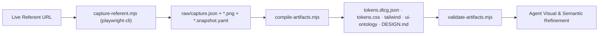

# Refract Wiki

**Refract** reverse-engineers any live website into measured **W3C Design Tokens** (DTCG JSON), **CSS custom properties**, **Tailwind v4/v3 themes**, structured **UI ontologies** (`YAML`/`JSON`), and agent-ready **`DESIGN.md`** specifications.

It ships as a zero-dependency Node.js (`>= 18`) CLI powered by `playwright-cli`, and as a multi-provider plugin for **Claude Code**, **Antigravity**, **Codex**, and **Cursor**.

---

## Why Measure First?

Asking an AI coding assistant to "copy this website's style" from a single screenshot hallucinates hex codes, misses dark-mode overrides, invents hover/focus transitions, and blurs visual styling with structural layout. Refract measures live browser state first and refines second:

| Capability | Screenshot-Only Prompting | Refract |
| --- | --- | --- |
| **Color & Contrast** | Approximated hex values | Exact CSS variables + computed colors + WCAG 2.1 contrast pairing |
| **Themes & Viewports** | Single static frame | Multi-state matrix (`desktop-light`, `desktop-dark`, `mobile-light`) |
| **Interactive States** | Ignored or invented | Live Playwright `:hover` & `:focus-visible` style delta probing |
| **UI Ontology** | Unstructured prose | Formal YAML/JSON regions, component slots, composition & invariants |
| **Output Portability** | One-off CSS | W3C DTCG JSON, CSS vars, Tailwind v4 `@theme`, Tailwind v3 config, `DESIGN.md` |

---

## Extraction Pipeline

---

## Supported Platforms

- **Claude Code** — `.claude-plugin/plugin.json` (`/refract:extract-referent`, `/refract:audit-ui-ontology`, `referent-analyst`)
- **Antigravity** — `.antigravity-plugin/plugin.json` (`/extract-referent`, `/audit-ui-ontology`, `referent-analyst`, always-on `rules/AGENTS.md`)
- **OpenAI Codex** — `.codex-plugin/plugin.json` (`$extract-referent`, `$audit-ui-ontology`)
- **Cursor** — `.cursor-plugin/plugin.json` (`/extract-referent`, `/audit-ui-ontology`, `referent-analyst`, intelligent `.cursor/rules/refract-guardrails.mdc`)
- **Standalone CLI** — `node skills/extract-referent/scripts/capture-referent.mjs`

---

## Wiki Page Index

| Page | Description |
| --- | --- |
| [Installation & Provider Setup](Installation-and-Provider-Setup.md) | Prerequisites, support matrix, and setup for Claude Code, Antigravity, Codex, Cursor, and CLI |
| [Extraction Workflow](Extraction-Workflow.md) | Five-stage capture/refine/validate workflow, CLI flags, and two-referent Diff Mode |
| [Design Tokens & Output Formats](Design-Tokens-and-Output-Formats.md) | Complete schemas and integration examples for all 7 output artifacts and `raw/` captures |
| [Architecture & Heuristics](Architecture-and-Heuristics.md) | Browser probe internals, color clustering, WCAG pairing, scale inference, and plugin isolation |
| [Troubleshooting & FAQ](Troubleshooting-and-FAQ.md) | Solutions for `PATH`, SPA hydration, CORS stylesheets, dark-mode toggles, provider setup, and FAQ |
| [Contributing & Publishing](Contributing-and-Publishing.md) | Development rules, strict validation commands, marketplace packaging, and wiki publishing |
